<p align="center">
  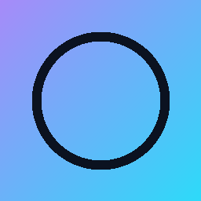
</p>

<h1 align="center">Project Nexus v5</h1>

<p align="center">
  <strong>A glassmorphic, performance-first project launcher built on Electron</strong>
</p>

<p align="center">
  <a href="#features"></a>
  <a href="#themes"></a>
  
  
  <a href="LICENSE"></a>
</p>

<br/>

<p align="center">
  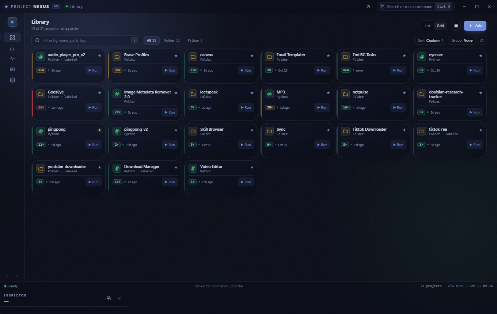
</p>

---

## What is this?

**Project Nexus** is a single-window desktop launcher that organizes all your local projects — scripts, folders, apps — into one browsable, searchable, launchable library. Think *Spotlight meets Steam*, built for developers who juggle dozens of side projects.

Every surface is a frosted-glass panel with live blur, ambient glow, film grain, and spring animations. Every slider, toggle, and threshold is exposed — tune the entire look and feel without touching code.

---

## Features

### 🗂️ Library

- **Card grid + list views** with live density cycling (ultra-compact 40 px → roomy 72 px)
- **Drag-to-reorder** with persistent custom sort
- **Type filters** — All · Folder · Python (auto-detected from target)
- **Tags & favorites** — eight color-coded labels, star/unstar, quick sidebar filters
- **Inline search** — fuzzy match on name, path, and tags (`/` to focus)
- **Heat map badges** — launch-count accents with configurable thresholds, palettes, and shapes
- **Bulk actions** — multi-select, batch delete, tag, run, favorite, stop

### ⚡ Launching

- One-click **▶ Run** from any card or the command palette
- **Custom shell commands** per project — arguments, working dir, per-project env vars
- **Kill previous instance** before re-launch (configurable)
- **Launch-at-login** and **start-minimized** for background-service projects
- **Process priority** selector (low → high, five Windows levels)
- Open folder, open terminal, copy path — all one shortcut away
- **Silent launches** — apps never open their own console; stdout/stderr is captured into rotated log files and tailed live in the Logs view
- Python apps get `PYTHONUNBUFFERED=1` automatically — no 8 KB output batching

### 📊 Analytics Dashboard

<p align="center">
  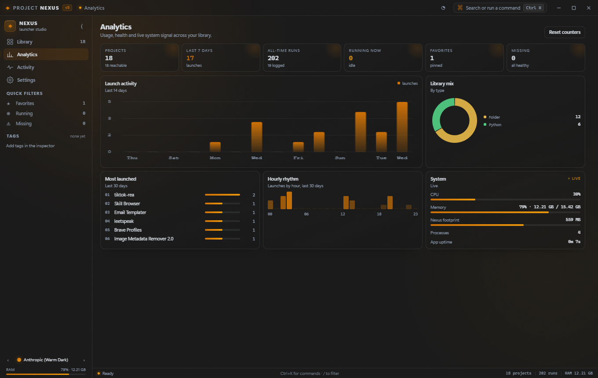
</p>

- **KPI row** — projects, last-7-day launches, all-time runs, running-now, favorites, missing
- **14-day launch activity** bar chart
- **Library mix** donut chart (by project type)
- **Most-launched** ranked list (30-day window)
- **Hourly rhythm** histogram — see when you code
- **Live system monitor** — CPU %, RAM (used / total), Nexus footprint, child process count, uptime

### 🔍 Inspector

<p align="center">
  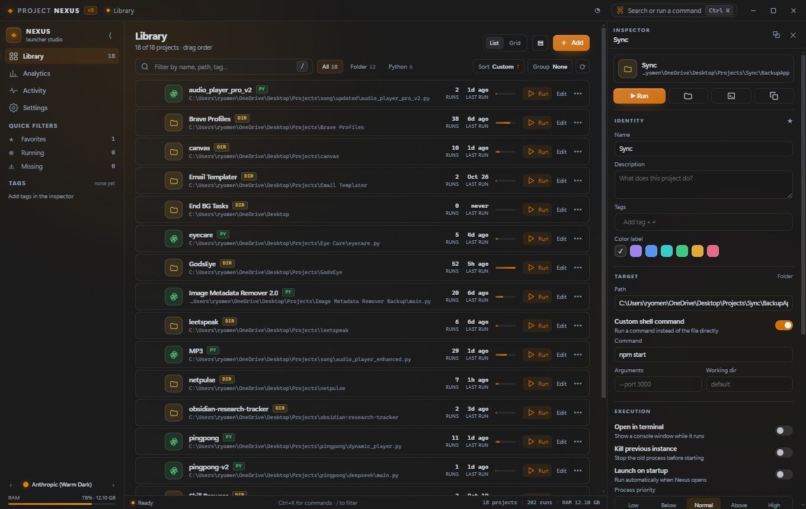
</p>

- Slide-out detail panel for the selected project
- Edit name, description, tags (color-coded swatches), target path, shell command, arguments
- Toggles: open in terminal, kill previous, launch on startup, console window
- Per-project env var key/value editor
- Details grid — file type, size, last modified, run stats
- Danger zone — delete, reset counters

### ⌨️ Command Palette

`Ctrl+K` opens a fuzzy-search overlay merging commands and projects — arrow keys to navigate, Enter to run.

<p align="center">
  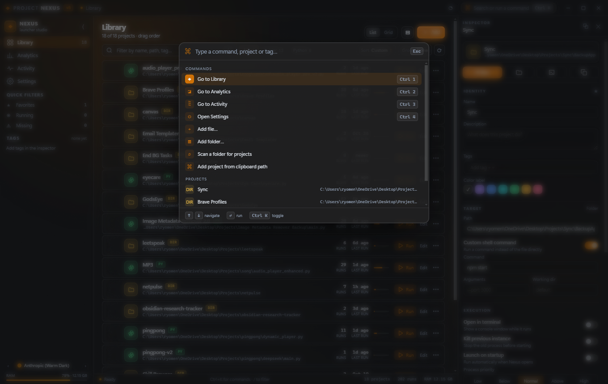
</p>

### 📋 Activity & Logs

<p align="center">
  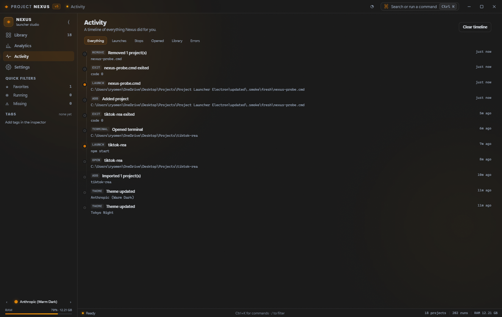
</p>

- Timestamped activity feed for every launch, stop, and config change
- Captured **stdout / stderr** log viewer with per-project scoping
- Stream filter (stdout / stderr / lifecycle), find-in-log, follow-tail
- Export filtered view to `.log`; open the log directory
- Bounded at 5 000 lines in memory / 1 200 DOM rows — chatty apps can't lag the UI
- Lifecycle lines with command, cwd, PID, exit code; stderr shown in red

---

## Themes

14 built-in themes (13 dark + 1 light), switchable from the sidebar, settings, or command palette:

| | Theme | Mode | | Theme | Mode |
|---|---|---|---|---|---|
| 1 | Carbon Black | Dark | 8 | Tokyo Night | Dark |
| 2 | Midnight Aurora | Dark | 9 | Gruvbox Dark | Dark |
| 3 | Cyberpunk Neon | Dark | 10 | Aurora Mint | Dark |
| 4 | Nordic Frost | Dark | 11 | Lavender Haze | Dark |
| 5 | Anthropic (Warm Dark) | Dark | 12 | Midnight Blue | Dark |
| 6 | Dracula Style | Dark | 13 | Forest Green | Dark |
| 7 | Rose Pine | Dark | 14 | **Porcelain** | **Light** |

<p align="center">
  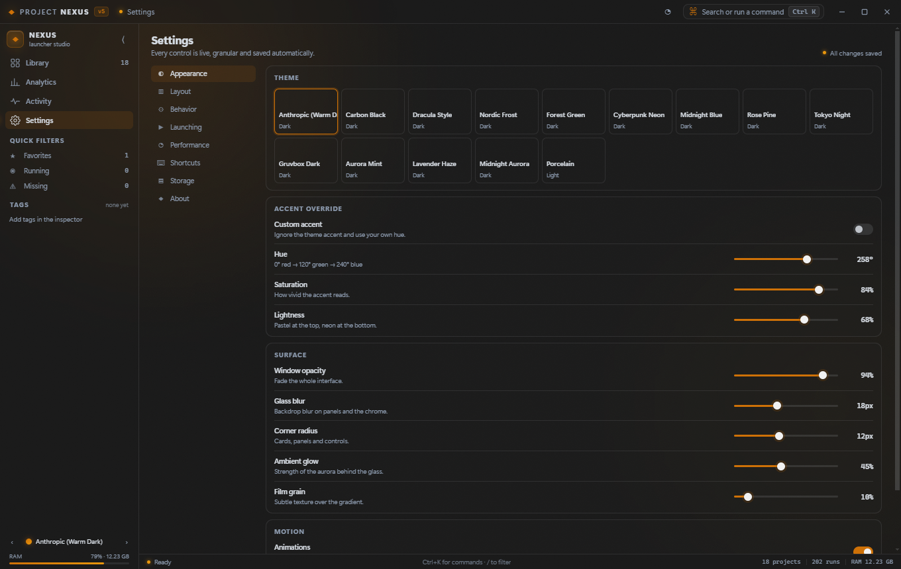
</p>

---

## Granular Appearance Controls

Every visual parameter is a live slider, saved automatically:

| Control | Range | Effect |
|---|---|---|
| Window opacity | 0 – 100 % | Fade the entire interface |
| Glass blur | 0 – 40 px | Backdrop blur depth on panels |
| Corner radius | 0 – 24 px | Cards, panels, and controls |
| Ambient glow | 0 – 100 % | Aurora intensity behind the glass |
| Film grain | 0 – 100 % | Subtle texture overlay |
| Motion scale | 0 – 2 × | Spring animation intensity |
| Font scale | 0.75 – 1.25 × | Global type size scaling |
| Row density | 40 – 96 px | Ultra compact → Roomy presets |
| Custom accent | HSL hue / sat / lightness | Override any theme's accent colour |

---

## Cards & Heat Map

<p align="center">
  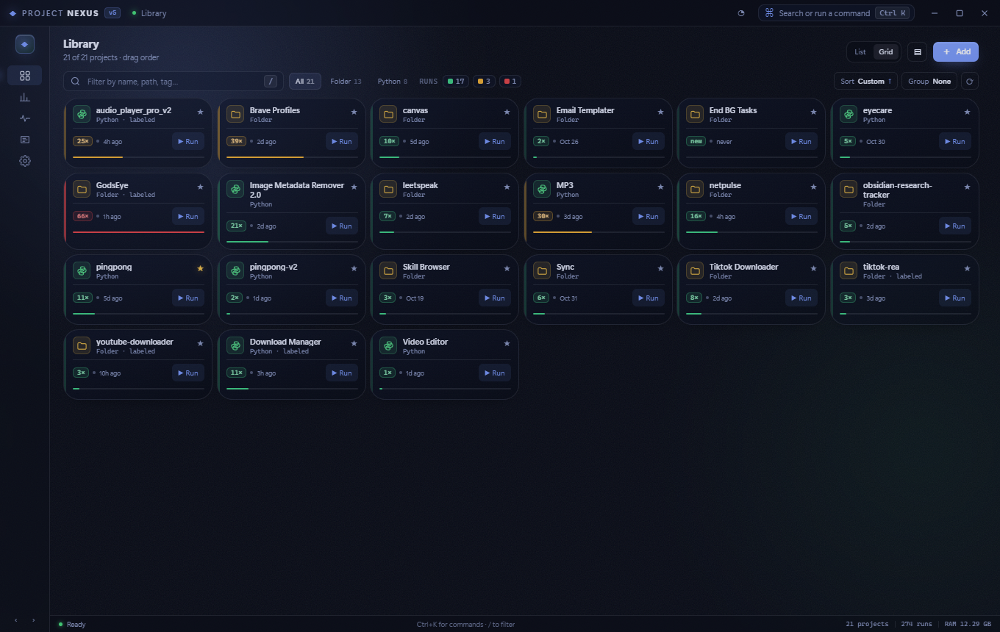
</p>

The grid view tints each card by launch frequency — green → amber → red:

- **Scale** — Relative (share of max), Absolute (20 runs = hot), Logarithmic
- **Palette** — Traffic-light, theme-derived ramp, or three custom colours
- **Shape** — Left spine, top edge, full border, outer glow; width & intensity sliders
- **Redundant signals** — Count chip, heat meter bar, toolbar legend with live tier counts
- **Sort by Heat** brings the most-launched projects to the front

---

## Keyboard Shortcuts

| Shortcut | Action |
|---|---|
| `Ctrl+K` | Command palette |
| `Ctrl+B` | Toggle sidebar |
| `Ctrl+Shift+P` | Performance HUD |
| `Ctrl+1` – `Ctrl+5` | Library / Analytics / Activity / Logs / Settings |
| `Ctrl+Alt+N` | Global hotkey — show Nexus from anywhere |
| `Ctrl+N` | Add file |
| `Ctrl+Shift+N` | Scan folder for projects |
| `Ctrl+Shift+T` | Cycle theme |
| `/` | Focus search filter |
| `↑ ↓` / `↵` | Navigate / launch selection |
| `Delete` | Remove selected project |
| `Esc` | Dismiss overlay |
| `F1` | Shortcut map |

---

## Performance

Not decorative — engineered:

- **Keyed DOM reconciliation** — rows are reused and patched in place, never rebuilt
- `content-visibility: auto` + CSS `contain` keeps off-screen work at zero cost
- **One delegated click handler** for the entire app — no per-row listener allocation
- rAF-batched renders with signature-cached tag/type/filter rebuilds
- Canvas-drawn charts with DPR scaling; polling suspends when the window is hidden
- Built-in **Performance HUD** (`Ctrl+Shift+P`) — live FPS, frame ms, render ms, DOM nodes, heap

---

## Getting Started

### Prerequisites

- [Node.js](https://nodejs.org/) 18+
- npm (ships with Node)

### Install & Run

```bash
git clone https://github.com/c0pperfi3ld/electron-project-launcher.git
cd electron-project-launcher
npm install
npm start
```

### Build for Distribution

```bash
npm run build        # unpacked app → dist/
npm run pack         # NSIS installer + portable .exe
```

### Smoke Test

Boots the real app **twice** (fresh install → reload on saved config), captures screenshots, probes the DOM, and runs a real process launch in each pass:

```bash
npm run smoke        # artifacts in .smoke/fresh/ and .smoke/reload/
```

---

## Project Structure

```
.
├── main.js                 # Main process — config, IPC, launch pipeline,
│                           #   stats, metrics, tray (1 442 lines)
├── preload.js              # Context bridge — 30+ IPC channels
├── renderer/
│   ├── index.html          # App shell, overlays, view scaffolds
│   ├── app.js              # Renderer — keyed rendering, palette,
│   │                       #   inspector, canvas charts (2 476 lines)
│   └── styles.css          # Token-driven glassmorphic design system
├── assets/
│   ├── app-icon.png
│   ├── folder.png
│   └── themes.json         # 14 theme definitions
├── nexus.config.json       # Default config schema (deep-merged at boot)
├── config/                 # User runtime data (gitignored)
│   ├── config.json
│   ├── history.json
│   ├── backups/
│   └── logs/
├── scripts/
│   └── smoke.js            # Automated smoke test harness
├── docs/                   # Screenshots
├── run.bat                 # Windows launcher
└── Run Nexus v5.vbs        # Windowless launcher
```

---

## Tech Stack

| Layer | Technology |
|---|---|
| Framework | Electron 31 |
| Builder | electron-builder (NSIS + portable) |
| Renderer | Vanilla JS — zero framework, zero build step |
| Styling | Pure CSS with custom properties, glassmorphism, CSS grid |
| IPC | `contextBridge` + `ipcRenderer.invoke` — 30+ typed channels |
| Config | JSON deep-merge with schema migration |
| Lines of code | ~5 400 (hand-written JS/CSS/HTML) |

---

## More Screenshots

<details>
<summary><strong>Card settings panel</strong></summary>
<br/>
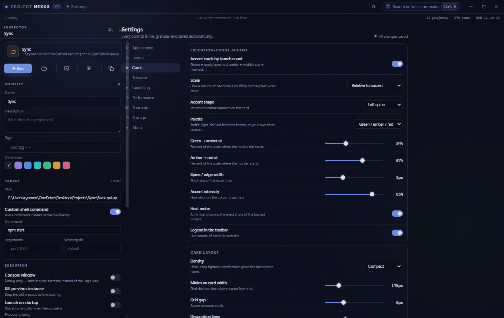
</details>

<details>
<summary><strong>Settings — cards with fixed layout</strong></summary>
<br/>
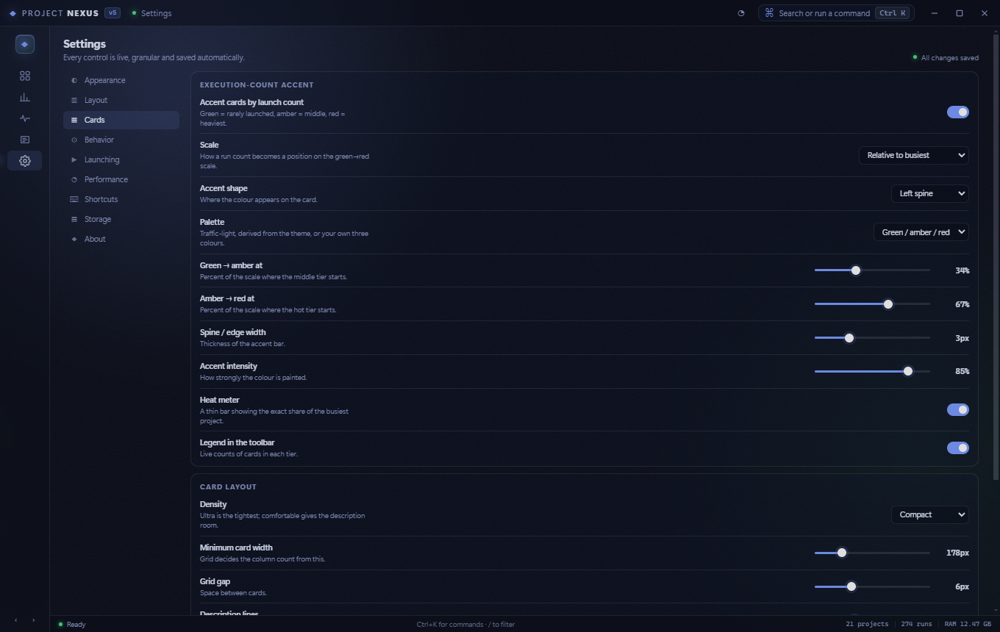
</details>

<details>
<summary><strong>Log viewer</strong></summary>
<br/>
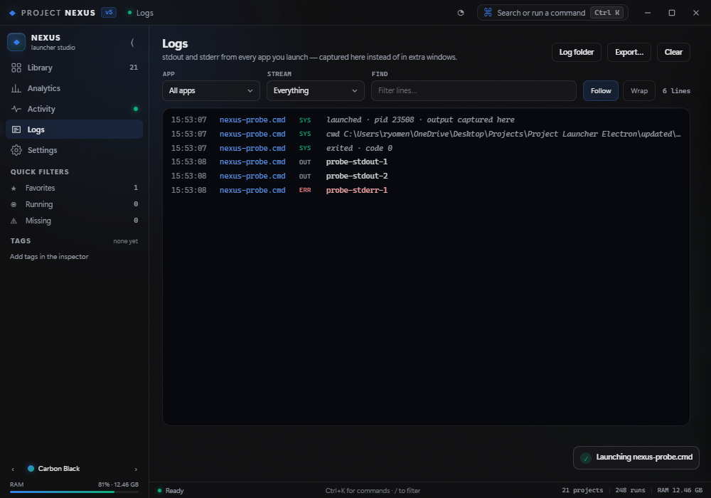
</details>

<details>
<summary><strong>Narrow / responsive window</strong></summary>
<br/>
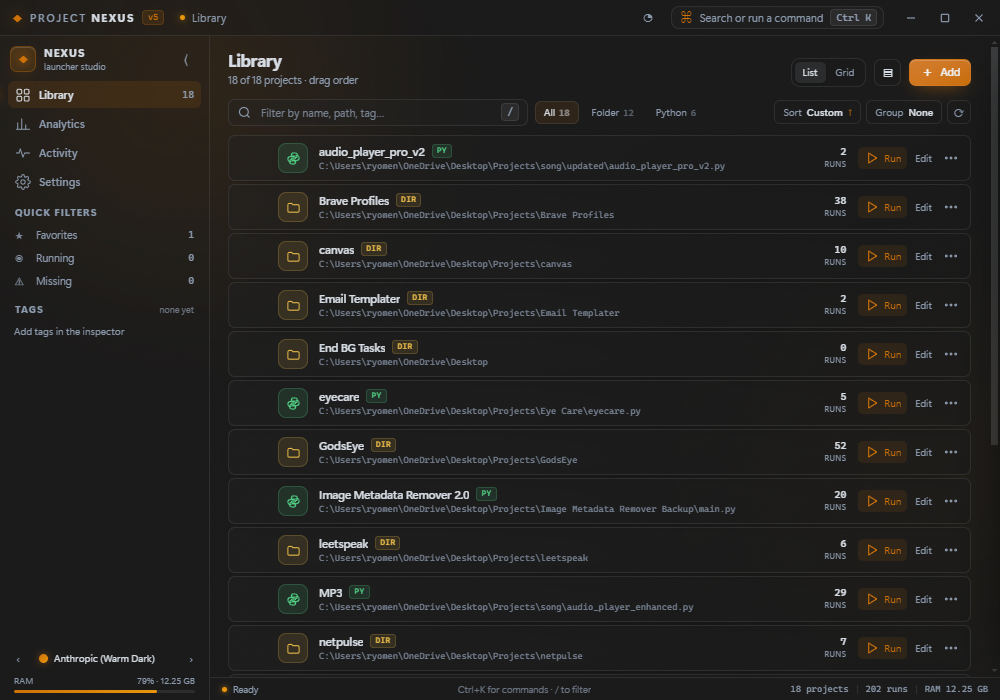
</details>

---

## License

[MIT](LICENSE) © 2026 [Miraj Khan](https://github.com/c0pperfi3ld)
